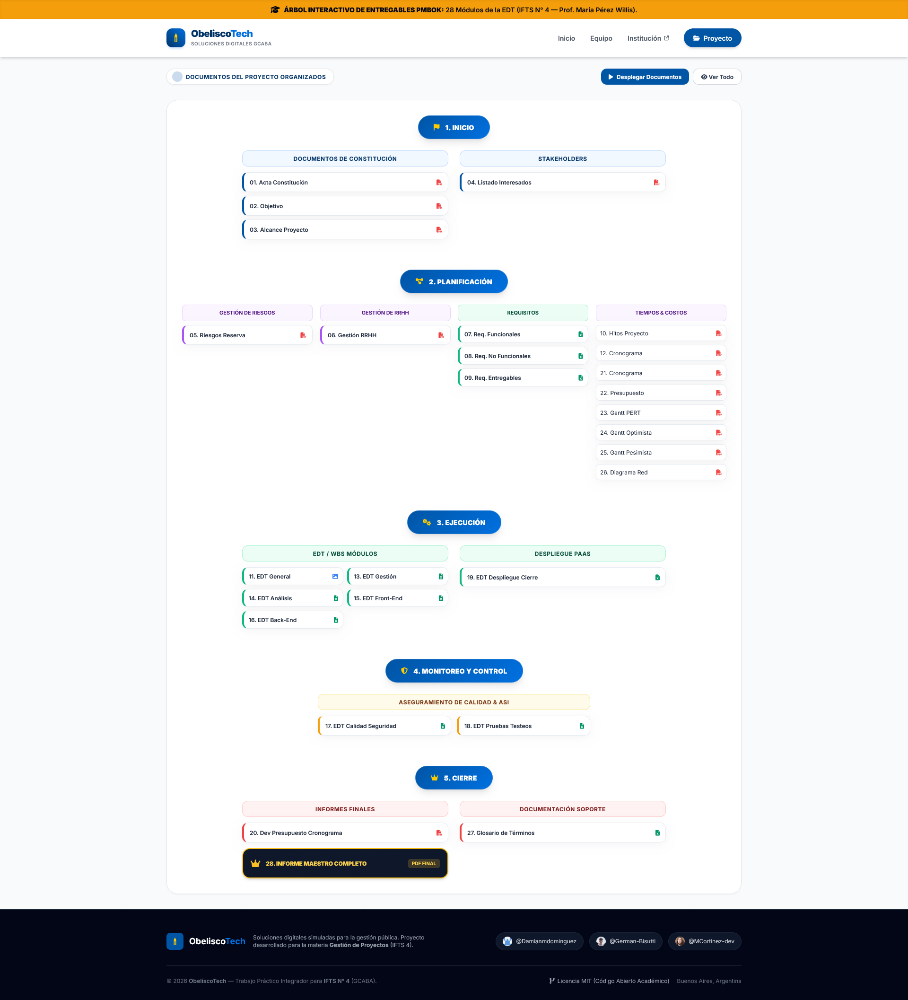

# ObeliscoTech — Sistema de Formularios del GCABA
> **Trabajo Práctico Integrador de Cierre de Carrera**  
> **Instituto de Formación Técnica Superior N° 4 (IFTS 4)** — Gobierno de la Ciudad de Buenos Aires.  
> **Materia:** Gestión de Proyectos | **Curso:** 3° Año, Último Cuatrimestre.  
> **Profesora:** María Pérez Willis.

[](https://gestion-proyectos-eight.vercel.app/proyecto.html)
[](LICENSE)

---

## 📌 Descripción del Proyecto

**ObeliscoTech** es una plataforma institucional simular desarrollada para dar respuesta a la licitación del **Sistema de Formularios del GCABA**. El objetivo del proyecto principal es diseñar e implementar un motor dinámico para la creación, publicación y administración centralizada de formularios de gestión pública, garantizando validaciones en tiempo real, trazabilidad auditada y reportes de métricas bajo los más altos estándares de calidad y seguridad estatal.

La documentación ejecutiva, técnica y financiera del proyecto fue planificada y estructurada siguiendo la metodología estándar **PMBOK® 5ta Edición** (PMI), dividida en 28 paquetes de trabajo y entregables maestros.

---

## 📸 Capuras de Pantalla (Screenshots)

| Portal Institucional (`index.html`) | Árbol Interactivo PMBOK (`proyecto.html`) |
| :---: | :---: |
|  |  |

---

## 👥 Equipo del Proyecto & Créditos Académicos

* **Matías Cortínez** — *Project Manager / PMO Lead* ([@MCortinez-dev](https://github.com/MCortinez-dev))
* **Germán Bisutti** — *Arquitecto de Software* ([@German-Bisutti](https://github.com/German-Bisutti))
* **Damián Domínguez** — *Líder de Calidad & QA Lead* ([@Damianmdominguez](https://github.com/Damianmdominguez))

---

## 🚀 Tecnologías y Herramientas Utilizadas

### **Front-End & Portal Interactivo**
* **HTML5 & JavaScript (ES6+):** Renderizado dinámico, visor integrado de documentos PDF/Excel y controladores de navegación panorámica (*drag & touch*).
* **Tailwind CSS (CDN):** Diseño responsivo y estético con paleta de colores institucional del GCABA (`#0055A5`, `#003366`, `#FFCC00`).
* **SVG Animations:** Dibujo progresivo del árbol de dependencias (`stroke-dashoffset`).
* **SheetJS (XLSX):** Motor de procesamiento y renderizado dinámico en tiempo real para planillas de cálculo sin filas/columnas vacías.
* **FontAwesome 6 & Google Fonts (Inter):** Iconografía corporativa y tipografía oficial.

### **Stack del Sistema Simulado (Propuesta Técnica)**
* **Back-End:** Java Spring Boot en arquitectura de microservicios.
* **Front-End:** React con la librería de componentes **Obelisco Design System (GCABA)**.
* **Autenticación & Seguridad:** Keycloak OIDC, RBAC, cumplimiento OWASP Top 10 y normativas ASI (ES0901/ES0902).
* **Despliegue PaaS:** Imágenes en contenedores orquestadas mediante Red Hat OpenShift.

---

## 📂 Estructura del Repositorio

```text
.
├── index.html                  # Portal principal institucional de ObeliscoTech
├── proyecto.html               # Visualizador interactivo en árbol de los 28 entregables PMBOK
├── components/
│   ├── header.html             # Componente de navegación reutilizable
│   └── footer.html             # Componente de pie de página reutilizable
└── docs/                       # Repositorio de los 28 entregables en PDF, PNG y XLSX
    ├── 01_Acta_Constitucion.pdf
    ├── 02_Objetivo.pdf
    ├── 03_Alcance_Proyecto.pdf
    ├── 04_Listado_Interesados.pdf
    ├── 05_Gestion_Riesgos_Reserva.pdf
    ├── 06_Gestion_RRHH.pdf
    ├── 07_Requisitos_Funcionales.xlsx
    ├── 08_Requisitos_No_Funcionales.xlsx
    ├── 09_Requisitos_Entregables.xlsx
    ├── 10_Hitos_Proyecto.pdf
    ├── 11_EDT.png
    ├── 12_Cronograma.pdf
    ├── 13_EDT_Gestion_Proyecto.xlsx
    ├── 14_EDT_Analisis_Diseno.xlsx
    ├── 15_EDT_Front_End.xlsx
    ├── 16_EDT_Back_End.xlsx
    ├── 17_EDT_Calidad_Seguridad.pdf.xlsx
    ├── 18_EDT_Pruebas_Testeos.xlsx
    ├── 19_EDT_Despliegue_Cierre.xlsx
    ├── 20_Desarrollo_Presupuesto_Cronograma.pdf
    ├── 21_Cronograma.pdf
    ├── 22_Presupuesto.pdf
    ├── 23_Gantt_Duracion_PERT.pdf
    ├── 24_Gantt_Duracion_Optimista.pdf
    ├── 25_Gantt_Duracion_Pesimista.pdf
    ├── 26_Diagrama_Red.pdf
    ├── 27_Glosario_Terminos.xlsx
    ├── 28_Informe_Maestro_Completo.pdf
    ├── screenshoot-1.png
    └── screenshoot-2.png
```

---

## 🎓 Metodología PMBOK (5 Fases Jerárquicas)

El visualizador interactivo (`proyecto.html`) ramifica la documentación en **5 fases clave de la Gestión de Proyectos**:

1. **INICIO:** Acta de Constitución, Objetivos, Alcance General y Matriz de Stakeholders.
2. **PLANIFICACIÓN:** Gestión de Riesgos, Matriz de RRHH, Especificación de Requisitos (RF/RNF), Hitos, Cronograma Base, Diagramas de Gantt (PERT, Optimista, Pesimista) y Diagrama de Red (PDM/AON).
3. **EJECUCIÓN:** Estructura de Desglose del Trabajo (EDT/WBS) por módulos (Gestión, Análisis, Front-End, Back-End y Despliegue).
4. **MONITOREO Y CONTROL:** Aseguramiento de Calidad, Normativas ASI y Matriz de Pruebas E2E.
5. **CIERRE:** Desarrollo de Presupuesto/Costos, Glosario de Términos y el **Informe Maestro Completo (Entregable Cúpula)**.

---

## 📄 Licencia

Este proyecto se distribuye bajo la licencia **MIT**. Desarrollado con fines exclusivamente académicos para el **IFTS N° 4** (2026).
